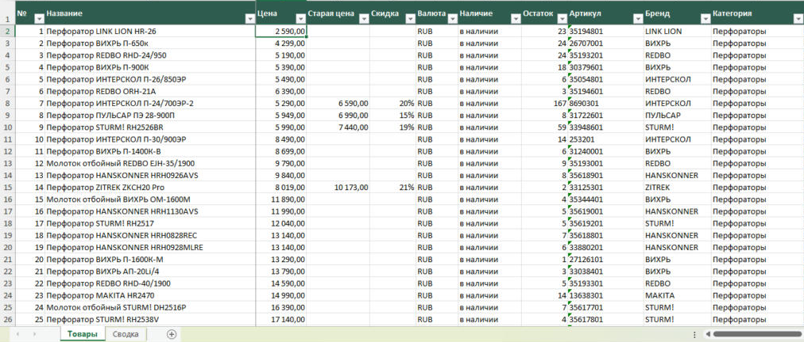
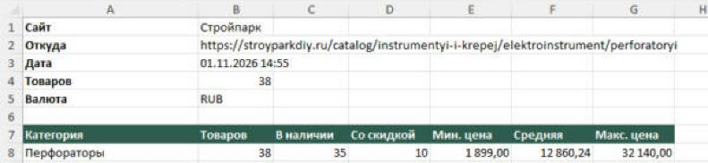
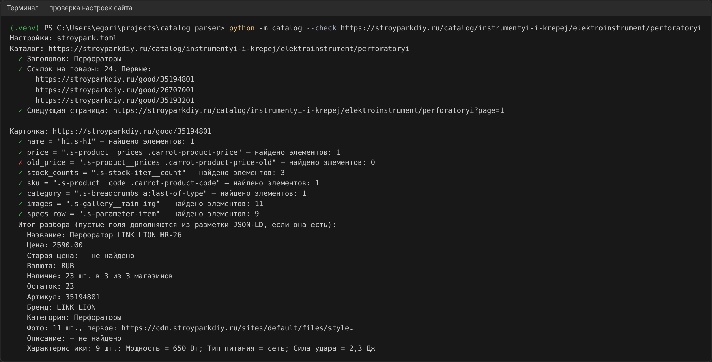

# Catalog Parser — каталог интернет-магазина в Excel

[](https://github.com/SHUHER322/catalog_parser/actions/workflows/tests.yml)

Парсер каталогов интернет-магазинов на **Scrapy**. Даёте ссылку на категорию — он проходит
все страницы каталога, открывает каждую карточку и собирает название, цену, старую цену,
наличие и остатки, артикул, бренд, фото и все характеристики. Результат — Excel с листами
«Товары» и «Сводка» и CSV, который открывается в русском Excel без «кракозябр».

Под новый сайт код не меняется: пишется небольшой файл настроек с CSS-селекторами, а
проверка `--check` за секунды показывает, что нашёл каждый селектор.

**Стек:** Python 3.14, Scrapy, BeautifulSoup, openpyxl, Docker, pytest + GitHub Actions.

## Как это выглядит

**Лист «Товары»** — товары в порядке каталога, цены числами, скидка в процентах,
остатки по магазинам, кликабельные ссылки, каждая характеристика — отдельный столбец:



<table>
  <tr>
    <th>Лист «Сводка»</th>
    <th>Проверка настроек сайта</th>
  </tr>
  <tr>
    <td></td>
    <td></td>
  </tr>
</table>

## Возможности

**Результат**
- Excel: шапка и название закреплены, фильтры, цены в числовом формате, ссылки на товар и фото
- «Сводка»: по категориям — сколько товаров, в наличии, со скидкой, мин./средняя/макс. цена
- CSV для русского Excel (UTF-8 с BOM, разделитель `;`, десятичная запятая)
- Товары идут в том же порядке, что и на сайте

**Сайты**
- Новый сайт — файл `sites/<сайт>.toml` с CSS-селекторами, без правки кода
- Пустые поля дозаполняются из разметки для поисковиков (JSON-LD, микроразметка schema.org):
  на многих сайтах карточка разбирается вообще без селекторов
- Цена ищется только в блоке самого товара — цены из «Вы смотрели» и «Похожие» не попадают
- Остатки по нескольким магазинам складываются: «8 шт. в 2 из 3 магазинов»
- Снятые с продажи товары пропускаются (`skip_text`)
- Ссылка может быть и на категорию, и прямо на карточку

**Бережно и надёжно (возможности Scrapy)**
- Соблюдает `robots.txt`, пауза между запросами и ограничение одновременных запросов
- AutoThrottle: сайт стал отвечать медленнее — парсер сам замедляется
- Повторы при обрывах и ошибках сервера, включая 429 «слишком часто»
- `--resume`: можно прервать (Ctrl+C) и продолжить с того же места; собранное не теряется
- Если прошлый Excel открыт — результат сохраняется рядом, а не теряется

**Удобство**
- Строка прогресса вместо служебного лога; полный лог — в файле
- Понятные причины, если результат пустой: сайт не ответил, закрыт защитой от ботов,
  неверный селектор каталога или карточки
- 76 тестов на сохранённых страницах (в том числе настоящего магазина), автозапуск в GitHub Actions

## Запуск

```bash
python -m venv .venv                   # Windows: py -V:3.14 -m venv .venv
source .venv/bin/activate              # Windows: .venv\Scripts\activate
pip install -r requirements.txt

python -m catalog https://stroyparkdiy.ru/catalog/instrumentyi-i-krepej/elektroinstrument/perforatoryi
```

```
Сайт: Стройпарк. Остановить: Ctrl+C (собранное сохранится)
Страниц каталога: 2 | товаров: 38 из 38 | 1 мин 14 с

Готово за 1 мин 14 с: товаров 38.
Файлы: output/stroyparkdiy_ru.xlsx, output/stroyparkdiy_ru.csv
Подробный лог: output/stroyparkdiy_ru.log
```

| Параметр | Что делает |
|---|---|
| `ССЫЛКА [ССЫЛКА ...]` | одна или несколько категорий одного сайта (или карточек) |
| `--check` | проверить настройки сайта: одна страница каталога и одна карточка |
| `--limit N` | не больше N товаров — для пробного запуска |
| `--resume` | можно прервать и потом продолжить той же командой |
| `--format xlsx` / `csv` | только один формат (по умолчанию оба) |
| `--out путь` | куда сохранить (по умолчанию `output/<сайт>`) |
| `--site файл.toml` | взять настройки из этого файла |
| `--verbose` | полный лог Scrapy на экран |

Тесты: `pip install -r requirements-dev.txt && pytest`

## Как добавить новый сайт

1. Скопируйте `sites/books_toscrape.toml` в `sites/<сайт>.toml` и укажите домен.
2. Откройте страницу категории в браузере, нажмите F12 и найдите:
   - ссылку на карточку товара в плитке каталога → `product_link`;
   - кнопку «Следующая страница» → `next_page`.
3. Откройте карточку товара и найдите название, цену, старую цену, наличие, артикул,
   фото, строки характеристик → раздел `[product]`. Что сайт отдаёт в разметке
   JSON-LD, можно не указывать — найдётся само.
4. Проверьте:
   ```bash
   python -m catalog --check https://сайт.ru/catalog/категория
   ```
   У каждого селектора — ✓ или ✗ и число найденных элементов, ниже — что получилось в каждом поле.
5. Пробный запуск: `python -m catalog ССЫЛКА --limit 10`.

Пример настроек настоящего магазина — [`sites/stroypark.toml`](sites/stroypark.toml):

```toml
name = "Стройпарк"
domains = ["stroyparkdiy.ru"]
currency = "RUB"

[listing]
product_link = "a.carrot-product-item-link"
next_page = "li.pager-next a"

[product]
name = "h1.s-h1"
price = ".s-product__prices .carrot-product-price"
old_price = ".s-product__prices .carrot-product-price-old"
stock_counts = ".s-stock-item__count"           # остатки по магазинам — складываются
sku = ".s-product__code .carrot-product-code"
brand_spec = "Производитель"                    # бренд — строка в характеристиках
category = ".s-breadcrumbs a:last-of-type"
images = ".s-gallery__main img"
specs_row = ".s-parameter-item"
specs_key = ".s-parameter-item__title"
specs_value = "footer"
skip_text = "Товар снят с публикации"           # страница есть, а товара уже нет — пропускаем

[crawl]
delay = 1.5
concurrency = 1
```

Ошибки в файле объясняются по-русски: `stroypark.toml [product]: неизвестные ключи: prise`.

## Запуск в Docker

```bash
docker build -t catalog_parser .
docker run --rm -v "$PWD/output:/app/output" catalog_parser https://stroyparkdiy.ru/catalog/... --limit 10
```

Свои настройки сайтов — без пересборки образа: `-v "$PWD/sites:/app/sites"`.
Для `--resume` подключите ещё папку `-v "$PWD/data:/app/data"`.

## Как устроено

```
sites/*.toml      — настройки сайтов
catalog/
  spider.py       — паук Scrapy: категория → страницы → карточки
  parse.py        — разбор страниц (чистые функции, тестируются без интернета)
  markup.py       — JSON-LD, микроразметка, мета-теги
  config.py       — чтение и проверка настроек
  settings.py     — настройки Scrapy: вежливость, повторы, продолжение
  pipelines.py    — товар сразу в черновик, в конце — Excel и CSV
  export.py       — Excel (Товары + Сводка) и CSV
  progress.py     — прогресс и объяснение проблем
  check.py        — проверка настроек --check
```

Паук только ходит по ссылкам, а что взять со страницы, решают чистые функции в
`parse.py`. Поэтому почти вся логика проверяется тестами на сохранённых страницах.

## Ограничения

Сайты, где каталог рисуется скриптами или закрыт защитой от ботов (Wildberries, Ozon, DNS),
так не открыть — нужен настоящий браузер. Такой режим есть в моём проекте
[price_sheet](https://github.com/SHUHER322/price_sheet) и добавляется под задачу.

## Что можно добавить под заказчика

Выгрузка в Google Таблицы, скачивание фото в папку, запуск по расписанию с
отчётом об изменениях цен и ассортимента, обход нескольких категорий из списка,
браузерный режим для защищённых сайтов.
